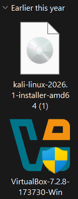
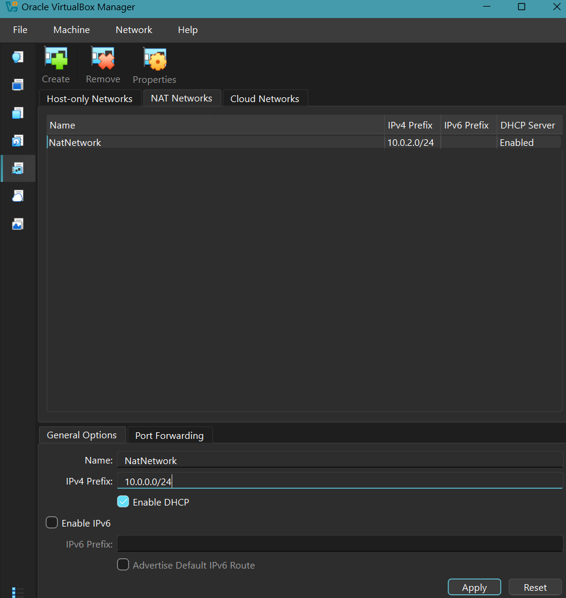
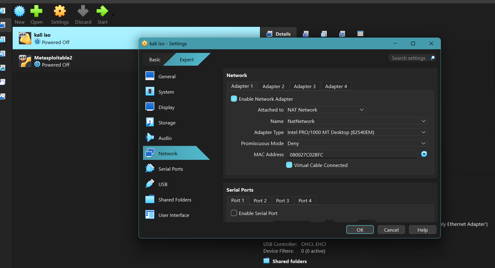
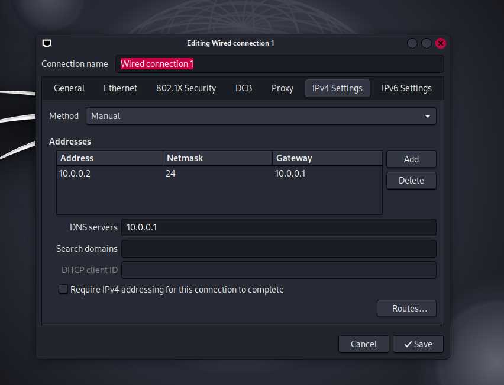
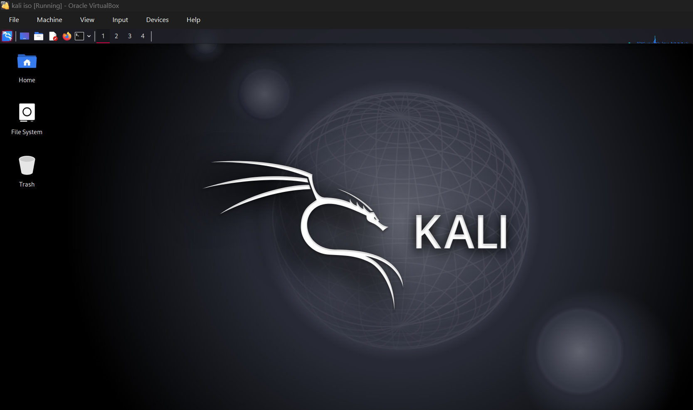
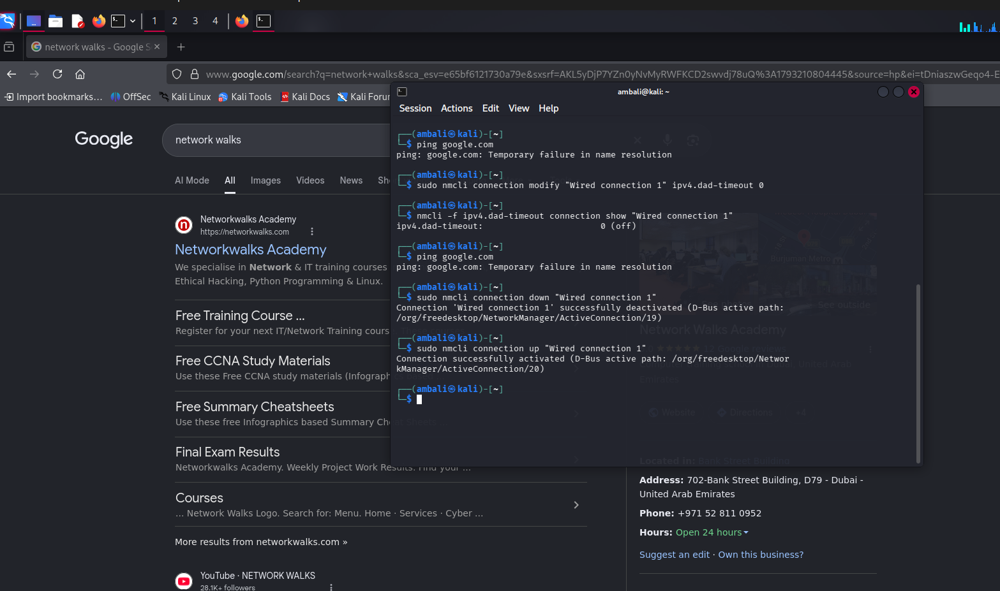
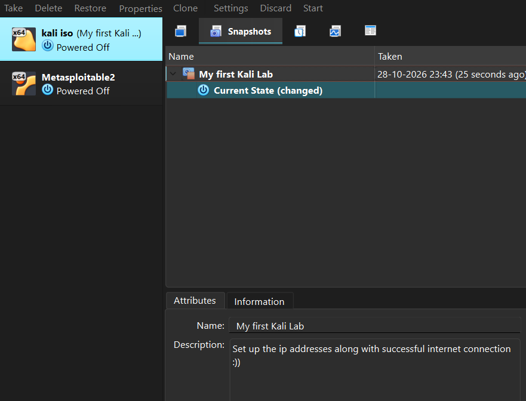

# 🔐 Cybersecurity Lab: Network Setup on Kali Linux

**Configuring a NAT Network, static IP address, connectivity verification, and a clean snapshot in VirtualBox.**


---

## 📌 Overview

As part of Week 1 of my cybersecurity internship at Networkwalks, I configured the networking for an existing Kali Linux virtual machine in VirtualBox.

The project involved creating a private NAT Network, assigning a static IP address, verifying network and DNS connectivity, troubleshooting an internet connectivity issue, and creating a clean snapshot for future lab experiments.

This setup provides a foundation for adding other virtual machines for authorized cybersecurity testing.

## 🎯 Objectives

- Create a private NAT Network in VirtualBox.
- Connect the Kali Linux VM to the network.
- Configure a static IPv4 address.
- Verify gateway, internet, and DNS connectivity.
- Troubleshoot connectivity using NetworkManager.
- Create a clean snapshot as a recovery point.

## ⚙️ Lab Configuration

| Component | Configuration |
|---|---|
| Host OS | [Your operating system] |
| Hypervisor | VirtualBox [version] |
| Guest OS | Kali Linux [version] |
| Allocated RAM | [Your configured RAM] |
| Network Type | NAT Network |
| Network Name | `NatNetwork` |
| Network Address | `10.0.0.0/24` |
| Kali IP Address | `10.0.0.2/24` |
| Gateway | `10.0.0.1` |
| DNS Server | `8.8.8.8` |

## 🪜 Implementation

### Step 1: Existing Kali Linux Environment

VirtualBox and a Kali Linux virtual machine were already installed on my system, so I used the existing VM as the base for this networking lab.



### Step 2: Create a NAT Network

Created a NAT Network through VirtualBox's network settings.

- **Network Name:** `NatNetwork`
- **IPv4 Prefix:** `10.0.0.0/24`
- **DHCP:** Enabled
- **IPv6:** Disabled



A NAT Network allows connected virtual machines to communicate with each other and access external networks through network address translation.

### Step 3: Connect Kali Linux to the NAT Network

Configured Adapter 1 of the Kali Linux VM to use the `NatNetwork` network.



### Step 4: Configure a Static IP Address

Configured the Kali Linux network interface with the following settings:

- **IP Address:** `10.0.0.2`
- **Subnet Mask:** `255.255.255.0`
- **Default Gateway:** `10.0.0.1`
- **DNS Server:** `8.8.8.8`



A static IP address provides a predictable address for the virtual machine during lab exercises. The selected address must not conflict with another device or an address assigned by DHCP.

### Step 5: Verify Network Connectivity

Used Linux networking utilities to inspect the interface and test connectivity.

```bash
ip a
ping 10.0.0.1
ping 8.8.8.8
nslookup networkwalks.com
```

These commands help verify the interface configuration, gateway reachability, external IP connectivity, and DNS resolution.



### Step 6: Troubleshoot the Connectivity Issue

**Problem:** After configuring the static IP address, Kali Linux could no longer access the internet.

**Solution:** Modified the NetworkManager connection's Duplicate Address Detection (DAD) timeout setting and restarted the connection.

First, checked the available connection profiles:

```bash
nmcli connection show
```

Then applied the configuration change and restarted the connection:

```bash
sudo nmcli connection modify "Wired connection 1" ipv4.dad-timeout 0
sudo nmcli connection down "Wired connection 1"
sudo nmcli connection up "Wired connection 1"
```

After the change, retested external IP connectivity and DNS resolution.



> **Note:** The connection name may differ between systems. The DAD setting is a troubleshooting change specific to this setup, not a universal fix for static IP connectivity issues.

### Step 7: Create a Clean Snapshot

Created a VirtualBox snapshot named:

`My first kali lab`

The snapshot provides a known recovery point that can be restored before or after future lab experiments.



## 💡 What I Learned

- **NAT Networking:** Learned how a NAT Network allows virtual machines to communicate with each other while accessing external networks.
- **Static IP Configuration:** Gained practical experience configuring an IP address, subnet mask, gateway, and DNS server for a Linux VM.
- **Network Troubleshooting:** Used `ping`, `nslookup`, and `nmcli` to investigate and resolve a connectivity issue.
- **Virtual Machine Snapshots:** Learned how snapshots provide a recovery point before experimenting with network settings or other lab configurations.

## 🔐 Ethical Use

This lab is intended for educational purposes. Any future penetration testing will be performed only on systems I own or have explicit authorization to test.


**Program:** NETWORKWALKS Cybersecurity Internship
**Week:** 01  
**Project:** Cybersecurity and Pentesting Lab Setup
